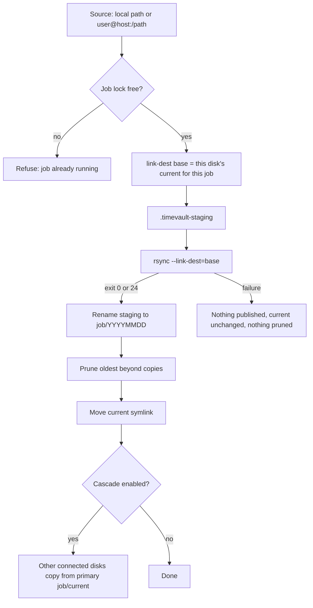

# Architecture overview

This page describes how Timevault stores and publishes backups **as the current release behaves**. Features that are still planned are listed at the end and are not available yet.

## The model in one paragraph

Each backup disk is an independent repository. Inside it, every job has its own directory containing one complete, browsable directory tree per backup day (a *generation*). Unchanged files in a new generation are hard links to the same file in the previous generation, so each generation costs only the space of what changed. Nothing on one disk depends on any other disk.

## Layout on a disk

```
<disk root>/
  .timevault                  disk identity (YAML file; id + filesystem UUID)
  <job>/
    20261017/                 a completed generation: a full tree of the source
    20261018/
    20261019/
    current -> 20261019       symlink to the latest completed generation
    .timevault-staging/       in-progress generation (exists only during a run)
    .timevault-replaced-<day>/  transient, only during a same-day replacement
    .timevault-publishing     transient note used to finish an interrupted same-day replacement
    .timevault-current.tmp    transient link renamed over `current`
```

Each published generation also contains a small `.timevault-complete` file at its top level. It is written just before the generation is published and holds a random token, so its presence means the generation was finished and published by Timevault. It appears when you browse or restore a generation and can be ignored.

- A generation is named after the **backup day**, which is the calendar day *before* the run starts. A run at 02:00 on 20 October writes `20261019`.
- `current` is only moved after a generation has been published successfully.
- A disk can hold several jobs. Each job keeps its own generations, its own `current` and its own retention.

## How a generation is built

1. **Lock the job.** A per-job lock (`/var/run/timevault.<job>.pid`) stops two runs of the *same* job. Different jobs can run at the same time (see [Parallel jobs](#parallel-jobs)).
2. **Prepare the source.** Remote jobs wake and inhibit suspend on the remote host if configured, then pre-hooks run.
2a. **Skip a completed day.** If the backup day already has a completed generation on this disk, the job is reported `already complete` and the steps below do not run, unless `--recreate` was given. This check happens before the remote host is woken. See [Skipping completed days and recreating](recreate.md).
3. **Pick the link-dest base.** The base is the directory `current` points to *on this disk, for this job*. If there is none, the run is a full initial backup. When recreating the day `current` already points at, the previous generation is the base and the existing day is added as a second, read-only reference.
4. **Prepare staging.** A leftover `.timevault-staging` is discarded when there is a base (its files could be hard links into completed generations). For an initial backup it is kept and rsync resumes into it.
5. **Run rsync** into `.timevault-staging` with `-ar --stats`, `--exclude-from`, `--link-dest=<base>`, and, unless `--safe`, `--delete-after --delete-excluded`. It retries up to three times. Exit code 0, or 24 (files vanished during the run), counts as success.
6. **Finish and publish.** On success the staged data is flushed to disk, `.timevault-complete` is added, and the staging directory is renamed to `<job>/<backup day>`. The rename is atomic on one filesystem, so an incomplete generation is never visible under a generation name, and the marker never exists before the data is on disk. If that day's generation already exists (a same-day re-run), the two directories are swapped in a single step (`renameat2` with `RENAME_EXCHANGE`) where the filesystem supports it, so the day's name never disappears; otherwise the old one is set aside first. The displaced old generation is removed afterwards.
7. **Retention.** Only after publishing, the oldest generations beyond `copies` are deleted. The generation `current` points to is never deleted.
8. **Move `current`** to the new generation by renaming a temporary link over it, so `current` is never missing or half-written. Then run post-hooks.

At the start of every run, Timevault first finishes or undoes any interrupted replacement, then checks `current`: if it is missing, dangling, or older than the newest generation carrying a completion marker (a run was interrupted after publishing but before moving `current`), it is pointed at that generation. Generations from releases that predate the marker are not chosen by this repair.

If rsync fails, nothing is published, `current` does not move, and nothing is pruned. Completed generations are never written to.



## Hard-link sharing

`rsync --link-dest` compares each source file with the file at the *same relative path* in the base generation. If size, modification time and the attributes rsync preserves (`-a`: permissions, owner, group, times) all match, the new generation gets a hard link to the existing file instead of a copy.

Consequences:

- Unchanged files cost no extra data blocks (they still cost directory entries).
- A changed file is written as a new file. Older generations keep their old copy.
- Completed generations are never modified, even when a permission or timestamp changes at the source: that file is simply stored again.
- A file that is **moved or renamed** is stored again, because the path differs. See [Retention and capacity](retention-capacity.md).
- Hard links cannot cross filesystems, so every disk stores its own copy of the data.

## Previous generation: per disk and per job

The "previous" generation is always the one `current` points to on **the disk being written, for the job being written**. It is not "yesterday", and it is not the newest generation on any other disk. A disk that was disconnected for three weeks uses its own three-week-old generation as the base for the next run. Rsync then transfers only what differs from that base. A long absence does not force a full backup.

## Cascade

With `--cascade` (or `options.cascade: true`), a job is first backed up to its *primary* disk from the original source. Every other eligible connected disk then copies that job's `current` from the primary instead of going back to the original source. Each of those disks still uses its own `current` as the link-dest base. See [Cascade](cascade.md).

## Disk identity

A disk is enrolled by filesystem UUID and carries a `.timevault` identity file. Before use, Timevault mounts the disk and checks the identity against the config. Disks are mounted only for the duration of a run, at a private per-process mount point.

## Parallel jobs

Two `timevault` processes may run **different** jobs at the same time, even against the same disk: locks are per job and mounts are per process. Make sure parallel jobs do not have overlapping source or destination directories; Timevault does not check this.

## Not available yet

These are planned and are **not** part of the current behaviour: a disk-local content index and detection of moved or renamed files. The plan is in [PLAN.md](PLAN.md).
