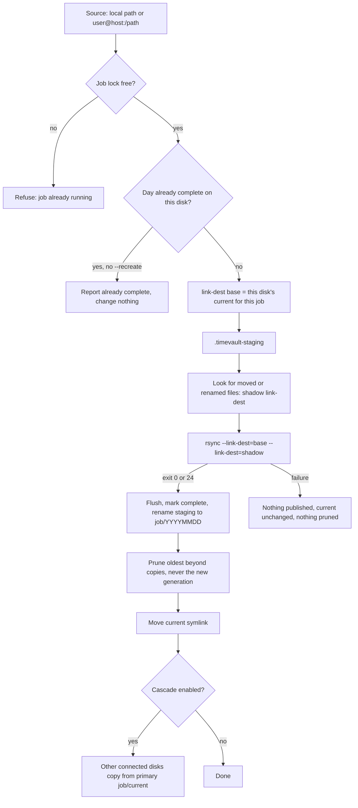

# Architecture overview

This page describes how Timevault stores and publishes backups **as the current release behaves**. Features that are still planned are listed at the end and are not available yet.

## The model in one paragraph

Each backup disk is an independent repository. Inside it, every job has its own directory containing one complete, browsable directory tree per backup day (a *generation*). Unchanged files in a new generation are hard links to the same file in the previous generation, so each generation costs only the space of what changed. Nothing on one disk depends on any other disk.

## Layout on a disk

```
<disk root>/
  .timevault                  disk identity (YAML file; id + filesystem UUID)
  <job>/
    20261017/                 a completed generation: a full tree of the source
    20261018/
    20261019/
    current -> 20261019       symlink to the latest completed generation
    .timevault-staging/       in-progress generation (exists only during a run)
    .timevault-replaced-<day>/  transient, only during a same-day replacement
    .timevault-publishing     transient note used to finish an interrupted same-day replacement
    .timevault-reloc/         transient hard links used to reuse moved or renamed files
    .timevault-current.tmp    transient link renamed over `current`
<disk root>/.timevault-index/file-index.sqlite   optional file index shared by all jobs on the disk
```

Each published generation also contains a small `.timevault-complete` file at its top level. It is written just before the generation is published and holds a random token, so its presence means the generation was finished and published by Timevault. It appears when you browse or restore a generation and can be ignored.

- A generation is named after the **backup day**, which is the calendar day *before* the run starts. A run at 02:00 on 20 October writes `20261019`.
- `current` is only moved after a generation has been published successfully.
- A disk can hold several jobs. Each job keeps its own generations, its own `current` and its own retention.

## How a generation is built

1. **Lock the job.** A per-job lock (`/var/run/timevault.<job>.pid`) stops two runs of the *same* job. Different jobs can run at the same time (see [Parallel jobs](#parallel-jobs)).
2. **Skip a completed day.** If the backup day already has a completed generation on this disk, the job is reported `already complete` and nothing below runs, unless `--recreate` was given. This happens before the remote host is woken. See [Skipping completed days and recreating](recreate.md).
3. **Prepare the source.** Remote jobs wake and inhibit suspend on the remote host if configured, then pre-hooks run.
4. **Pick the link-dest base.** The base is the directory `current` points to *on this disk, for this job*. If there is none, the run is a full initial backup. When recreating the day `current` already points at, the previous generation is the base and the existing day is added as a second, read-only reference.
5. **Prepare staging.** A leftover `.timevault-staging` is discarded when there is a base (its files could be hard links into completed generations). For an initial backup it is kept and rsync resumes into it. The [file index](#disk-local-file-index) is brought up to date with the base generation.
6. **Look for moved or renamed files** (on by default). A read-only dry run of the same rsync command against the base lists what is new and what vanished; matches are hard-linked under `<job>/.timevault-reloc`, which is offered to rsync as one more `--link-dest`. See [Reusing moved and renamed files](relocation.md). If anything goes wrong here, the run simply continues without it.
7. **Run rsync** into `.timevault-staging` with `-ar --stats`, `--exclude-from`, `--link-dest=<base>` (plus the scratch directory from step 6), and, unless `--safe`, `--delete-after --delete-excluded`. It retries up to three times. Exit code 0, or 24 (files vanished during the run), counts as success. The scratch directory is removed afterwards.
8. **Finish and publish.** On success the staged data is flushed to disk, `.timevault-complete` is added, the new generation is recorded in the file index, and the staging directory is renamed to `<job>/<backup day>`. The rename is atomic on one filesystem, so an incomplete generation is never visible under a generation name, and the marker never exists before the data is on disk. If that day's generation already exists (a `--recreate`), the two directories are swapped in a single step (`renameat2` with `RENAME_EXCHANGE`) where the filesystem supports it, so the day's name never disappears; otherwise the old one is set aside first. The displaced old generation is removed afterwards. Only then does the file index advance its roles.
9. **Retention.** Only after publishing, the oldest generations beyond `copies` are deleted. The generation just published is never deleted.
10. **Move `current`** to the new generation by renaming a temporary link over it, so `current` is never missing or half-written. Then run post-hooks.

At the start of every run, Timevault first finishes or undoes any interrupted replacement, then checks `current`: if it is missing, dangling, or older than the newest generation carrying a completion marker (a run was interrupted after publishing but before moving `current`), it is pointed at that generation. Generations from releases that predate the marker are not chosen by this repair.

If rsync fails, nothing is published, `current` does not move, and nothing is pruned. Completed generations are never written to.



## Hard-link sharing

`rsync --link-dest` compares each source file with the file at the *same relative path* in the base generation. If size, modification time and the attributes rsync preserves (`-a`: permissions, owner, group, times) all match, the new generation gets a hard link to the existing file instead of a copy.

Consequences:

- Unchanged files cost no extra data blocks (they still cost directory entries).
- A changed file is written as a new file. Older generations keep their old copy.
- Completed generations are never modified, even when a permission or timestamp changes at the source: that file is simply stored again.
- A file that is **moved or renamed** is stored again, because the path differs, unless moved-file detection (`options.relocation`, on by default) finds such files and reuses their data. See [Reusing moved and renamed files](relocation.md) and [Retention and capacity](retention-capacity.md).
- Hard links cannot cross filesystems, so every disk stores its own copy of the data.

## Previous generation: per disk and per job

The "previous" generation is always the one `current` points to on **the disk being written, for the job being written**. It is not "yesterday", and it is not the newest generation on any other disk. A disk that was disconnected for three weeks uses its own three-week-old generation as the base for the next run. Rsync then transfers only what differs from that base. A long absence does not force a full backup.

## Cascade

With `--cascade` (or `options.cascade: true`), a job is first backed up to its *primary* disk from the original source. Every other eligible connected disk then copies that job's `current` from the primary instead of going back to the original source. Each of those disks still uses its own `current` as the link-dest base. See [Cascade](cascade.md).

## Disk-local file index

Each disk keeps a SQLite database describing the files of its generations, at `<disk>/.timevault-index/file-index.sqlite`. It is kept while [moved-file detection](relocation.md) is on, which it is by default, or when `options.index: true` is set (see the [User Guide](../USER_GUIDE.md)). Its purpose is to let moved-file detection recognise files that were moved or renamed without reading everything again.

- **It belongs to the disk.** The database lives on the backup disk, uses paths relative to a generation (never a mount point), and is built only from that disk's own generations. A disk never needs another disk's index, and rotating a disk in or out needs no synchronisation.
- **It is not needed to restore.** Generations are ordinary directory trees; the index is an optimisation. If it is missing, stale or corrupt, it is rebuilt from the generations on the disk, and an index problem is reported as a warning and never fails a backup.
- **What it holds.** For each job, two sets of rows: the **previous** generation (the last completed one, used as the reference) and the **current** one (being built). For each regular file or symlink: relative path, name, size, modification time to the nanosecond, inode, link count, mode, owner and group. Older generations are not indexed.
- **Lifecycle per run.** (1) Load the previous rows, or rebuild them if the stored generation name or completion token differs from the reference, or the row count does not match. (2) Walk the finished staging tree into the current rows. (3) After the generation is published, in one transaction make "current" the new "previous" and drop the old rows. A failed run drops the current rows and leaves "previous" alone. If the process dies between publishing and step 3, the next run notices the mismatch and rebuilds, so the filesystem is always authoritative.
- **Contents are hashed lazily.** Nothing is hashed during a backup. A SHA-256 is computed only when something asks for it, and is stored keyed by inode, size and modification time, so hard-linked copies share one hash. A stored hash is used only after the file's current size, modification time and inode are checked against the record; a file that changed (or changes while being read) is reported stale instead of being given a hash of unknown provenance. Size and modification time alone are never treated as proof of identity. Inode change time is deliberately not used, because hard-linking a file into a new generation changes it.
- **Parallel jobs.** All jobs on a disk share one database in WAL mode with a busy timeout; each job reads and writes only its own rows.
- **Cost.** Measured on 100,000 files (release build, warm cache): a full build takes about 0.4 s, recording and publishing a new generation about 1 s, a no-change reuse check about 2 ms, a lookup a few milliseconds, and the database about 50 MB. Expect it to grow with the number of files and the length of their paths.

## Disk identity

A disk is enrolled by filesystem UUID and carries a `.timevault` identity file. Before use, Timevault mounts the disk and checks the identity against the config. Disks are mounted only for the duration of a run, at a private per-process mount point.

## Parallel jobs

Two `timevault` processes may run **different** jobs at the same time, even against the same disk: locks are per job and mounts are per process. Make sure parallel jobs do not have overlapping source or destination directories; Timevault does not check this.

## Moved and renamed files

With `options.relocation`, files that were moved or renamed since the previous generation are found before the copy and their data is reused. A scratch directory `<job>/.timevault-reloc` of hard links is passed to rsync as an extra read-only `--link-dest`, so rsync can never write through to a completed generation. It is on by default and can be turned off with `options.relocation: false`. See [Reusing moved and renamed files](relocation.md).

The plan and its status are in [PLAN.md](PLAN.md).
