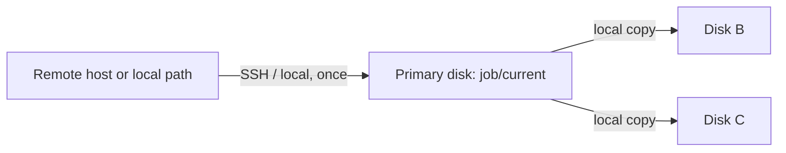

# Cascade guide

## Why cascade exists

A job whose source is a remote machine (`root@host:/path`) is expensive to read: every byte comes over SSH. If two or three backup disks are connected and each one read the remote machine itself, the same changes would cross the network two or three times, and the remote machine would be awake and busy for that much longer.

Cascade reads the original source **once**. The first disk (the *primary*) is backed up from the real source. Every other eligible connected disk is then filled from the primary's finished backup, which is a fast local disk-to-disk copy.



Cascade is shaped like a star, not a chain: disk B and disk C both copy from the primary, not from each other. One failing downstream disk therefore never blocks another.

## Enabling it

- Command line: `timevault backup --cascade`
- Config: `options: { cascade: true }`

Without cascade, only the primary disk receives each job's backup.

Cascade never writes to a disk marked `disabled: true`. A disk that is simply unplugged is not connected and is ignored. (Automatic runs also skip disks with the deprecated `rotatedOut` flag.)

## What happens on each downstream disk

For every job that reached the primary successfully:

1. The source of the job is rewritten to `<primary mount>/<job>/current`.
2. That job runs on the downstream disk exactly like a normal backup (same staging, publish, retention and `current` update).
3. The downstream disk uses **its own** `current` as the `--link-dest` base. It never uses the primary's history. If that disk was away for a week, it links against its own week-old generation and receives today's contents from the primary's `current`.

Disks keep independent histories. Nothing is copied between them except the one finished generation that is being cascaded.

## Success dependencies

- A job cascades only if its backup to the primary produced a snapshot in this run. If the primary job failed, was skipped (for example, a failed pre-hook) or was offline, the cascade for that job is skipped with a note. Disks do not copy a stale `current`.
- The primary's `current` is only moved after a generation is published, so a downstream disk can never read an incomplete generation as its source.
- If the cascade source directory is missing even though the primary succeeded, the run stops and reports an error.
- A job failing on one downstream disk is recorded in the report for that disk; later disks and jobs still run.
- A disk that cannot be mounted or verified, or a lock error, stops the run. Disks later in the order are not processed.
- Each disk has its own section in the backup report, so you can see exactly which disk and job succeeded.
- Timevault does **not** fall back to the original source if the primary stage fails.

Wake-on-LAN, suspend inhibition and remote hooks apply only to the primary stage. Cascaded jobs read a local path and ignore them.

## Examples

### Several Linux machines over SSH

```yaml
backupDisks:
  - diskId: "usb-a"
    fsUuid: "REPLACE-WITH-UUID-A"
  - diskId: "usb-b"
    fsUuid: "REPLACE-WITH-UUID-B"
options:
  cascade: true
jobs:
  - name: "web1"
    source: "root@web1.example.com:/"
    copies: 14
    run: "auto"
    excludes: ["/proc", "/sys", "/dev", "/run", "/tmp"]
  - name: "db1"
    source: "root@db1.example.com:/"
    copies: 14
    run: "auto"
    excludes: ["/proc", "/sys", "/dev", "/run", "/tmp"]
```

With both disks connected, `timevault backup` reads `web1` and `db1` over SSH once each into `usb-a`, then copies each job's `current` to `usb-b`.

### Two disks with different roles for different jobs

```yaml
jobs:
  - name: "photos"
    source: "/srv/photos"
    copies: 30
    diskIds: ["usb-a", "usb-b"]   # runs only on these disks
  - name: "scratch-archive"
    source: "/srv/archive"
    copies: 7
    diskIds: ["usb-b"]            # only ever on usb-b
```

`diskIds` limits which disks a job may use. The primary for each job is the first allowed, eligible, connected disk in config order.

### A disk that returns after a week

Disk C was offline. The cascade goes A (primary) then C. C's last generation is seven days old. C's run links against that generation and copies the differences from A's `current`. No historical generation is copied from A.

## Related

- [Rotation guide](rotation.md) for which arrangements benefit from cascade.
- [Architecture overview](architecture.md) for the generation lifecycle that each stage follows.
