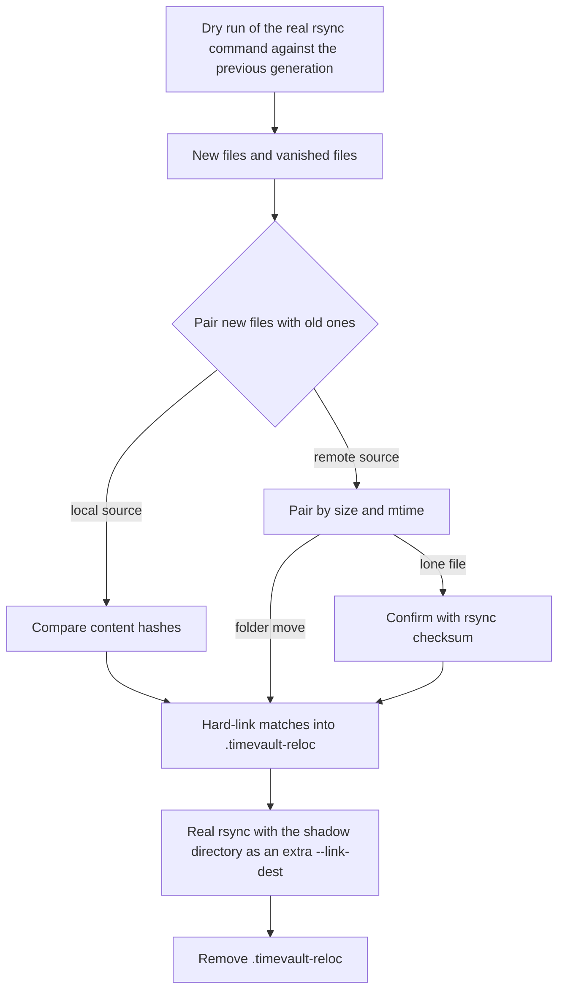

# Reusing moved and renamed files

## The problem

`rsync --link-dest` decides whether a file is unchanged by looking at the file with the **same relative path** in the previous generation. If you move a folder or rename files, the new paths have no counterpart, so rsync stores the content again even though identical data is already on the disk in the older generations. Reorganising a large collection can therefore consume as much space as the collection itself, and on a nearly full disk the next backup can fail.

Timevault can detect such files and reuse the existing data. It is **off by default**.

```yaml
options:
  relocation: true
```

## What it does



1. **Find what changed.** Timevault runs the real rsync command a second time as a *dry run* against the previous generation. Nothing is written. It reports the files that are new at the source and the files that vanished from it. The pass reads the source tree once, so for a remote source it costs an extra file-list exchange over SSH.
2. **Pair them.** A new file is paired with an old file when they have the same size and modification time (moving or renaming a file keeps its modification time) and, where possible, the same content. The disk-local [file index](architecture.md#disk-local-file-index) supplies the old files' details, which is why relocation switches the index on.
3. **Offer the data to rsync safely.** For each pairing, Timevault makes a hard link at the *new* path, pointing to the old file, inside a scratch directory `<job>/.timevault-reloc`. That directory is passed to rsync as one more `--link-dest`.
4. **Clean up.** The scratch directory holds only links, and is removed when the run ends (or at the start of the next run if the machine crashed).

### Why this is safe

rsync only ever *reads* a `--link-dest` directory. It hard-links a file from it into the new generation when every attribute rsync preserves (permissions, owner, group, time) matches the source, and otherwise writes a new file. It never writes through the reference. So even if the moved file's permissions, owner, timestamp or contents differ from the old copy, no file shared with a completed generation is modified. Tests move files while also changing their permissions and confirm the old generation keeps its original mode and inode.

If anything goes wrong, nothing is lost: the worst case is that rsync copies the file as it always did.

## How sure Timevault is: verification

A pairing is made on size and modification time (moving or renaming a file keeps its modification time). How much more evidence is required depends on the source and on `verify`:

| Source | `verify: auto` (default) | `verify: hash` | `verify: size-mtime` |
|---|---|---|---|
| **Local** (including a cascade source on another disk) | Content compared by SHA-256, up to `hashMaxSize`. Also finds duplicates of files that still exist. A file above the limit is not read; it is accepted only as a unique move. | Same, but a file above the limit is skipped: only content-checked files are offered. | No content comparison; unique moves only. |
| **Remote** (`user@host:/path`) | A **folder move** (three or more files going from one old folder to one new folder) is trusted without reading anything. A lone file within `hashMaxSize` is confirmed by rsync's own checksum. A lone file above the limit is accepted as a unique move. | Every pairing within `hashMaxSize` is confirmed by rsync's checksum; larger files are skipped. | Unique moves are trusted; nothing is read. |

- A **move** means the old path no longer exists at the source. A file that still exists at its old path is a **copy**, and a copy is only ever linked after its content has been compared, which needs a local source.
- If several candidates look alike (many files with the same size and modification time), they are told apart by content when the source is local. Otherwise they are left alone and rsync copies them.
- **Folder moves** are strong evidence: it takes several coincidences at once for unrelated files to line up as "everything in folder A is now in folder B". That is why a moved or renamed folder costs nothing extra to verify, while a single file, the case where a coincidence is most plausible, is checked.
- **Checksums are limited to the suspects.** Confirmation reads only the files that were paired, never the whole tree, and only up to `hashMaxSize` each (default 2 GiB; `0` removes the limit). A moved file is read on the remote host's disk, with only tiny checksums crossing the network. Remote confirmation uses the rsync already required on the remote: nothing is uploaded or run as root there, and file names never pass through a shell. rsync's checksum (xxHash or MD5, depending on version) is not SHA-256; it is meant to catch accidental look-alikes.
- **Huge files** are the one place content is not compared by default. A file above `hashMaxSize` whose size matches an old vanished file to the byte, with the same modification time to the second, is accepted as a move. If you want proof for those too, raise or remove the limit; if you want only proven pairings, use `verify: hash` and they are skipped.
- The weakest setting, `size-mtime`, is open to a mix-up: if a file vanishes and a *different* file with the same size and modification time appears in the same run, they can be confused. It is there for sources you cannot afford to read from.

Things that are not compared by Timevault itself (extended attributes, ACLs) are compared by rsync when it decides whether to link, so a mismatch there leads to a copy, not to wrong data.

## Configuration

```yaml
options:
  relocation: true            # defaults for everything else below
```

or, to tune it:

```yaml
options:
  relocation:
    enabled: true             # default true when this block is present
    minSize: 65536            # smallest file considered, in bytes (default 64 KiB)
    maxChanges: 200000        # give up if more files than this are new or vanished
    timeoutSeconds: 900       # give up if planning takes longer than this
    verify: auto              # auto | hash | size-mtime
    hashMaxSize: 2147483648   # largest file whose content is compared (default 2 GiB, 0 = no limit)
jobs:
  - name: "photos"
    source: "/srv/photos"
    copies: 20
    relocation: true          # per-job override of the global setting
  - name: "web1"
    source: "root@web1.example.com:/"
    copies: 14
    relocation: false
```

- `minSize` keeps the cost down: small files are cheap to copy. Lower it if your reorganisations involve many small files.
- `hashMaxSize` bounds how much is read to compare content. Raise it (or set `0`) if you want even huge files proven.
- Reaching `maxChanges` or `timeoutSeconds` abandons the pass for that run with a log line, and rsync copies everything normally. A large reorganisation therefore degrades to the old behaviour instead of making the backup slower.
- A job's own `relocation:` overrides the global setting in either direction.
- Relocation needs the file index and switches it on for the disk. See [the index cost](architecture.md#disk-local-file-index).

## What you will see

```
photos: reusing 1840 moved, renamed or duplicate files (9437184000 bytes) already in the previous generation
photos: moved-file detection skipped: more than 200000 new or vanished files
photos: moved-file detection stopped at its time limit; the rest is copied normally
photos: moved-file detection skipped: the file index is unavailable
```

Relocation never fails a backup. Any problem becomes a "skipped" line and the backup proceeds as before.

## Cost and benefit

Measured on a local filesystem with a warm cache, 20,000 files of about 4 KiB each, release build. "Next run" is the second backup; "extra disk" is the space the second generation added.

| Change before the next run | Without relocation | With relocation |
|---|---|---|
| Nothing | 0.30 s, 0.8 MiB | 0.55 s, 5.3 MiB (includes the index) |
| Every folder moved | 0.36 s, 157 MiB | 1.24 s, 10.6 MiB |
| Every file renamed (identical sizes and times) | 0.37 s, 157 MiB | 1.26 s, 9.6 MiB |

Reading the table:

- Relocation costs time on every run, roughly 12 microseconds per file here for the index and the dry-run pass, and about 40 microseconds per moved file for hashing. (These figures are from before the folder-move and size-limit rules; the local numbers are unaffected by them.) With few, large files the saving in copying and disk space dwarfs this; for a tree that never reorganises it is overhead you pay for nothing.
- These numbers are for a **local** source. The extra dry-run pass over **SSH** was not measured: it adds a file-list exchange with the remote host, which on a large tree over a slow link can take minutes. That is the reason `timeoutSeconds` exists, and why you may want `relocation: false` on slow remote jobs and `true` on local and cascade ones.
- The benchmark is reproducible: `cargo test --release bench_relocation -- --ignored --nocapture`.

## When it helps and when it does not

Helps: moving or renaming photo, video, music or document collections; reorganising a project tree; renaming many files in place; copying a large file to a second location (duplicates are linked when the source is local).

Does not help: files that are edited as well as moved (the new content must be stored); files below `minSize`; moves between jobs (each job's generations are separate); a file whose permissions or owner changed as it moved (rsync stores it anew; the old generation is untouched).

## Related

- [Retention and capacity](retention-capacity.md): how moves affect disk use.
- [Architecture: file index](architecture.md#disk-local-file-index).
- [Design rationale](design-rationale.md).
